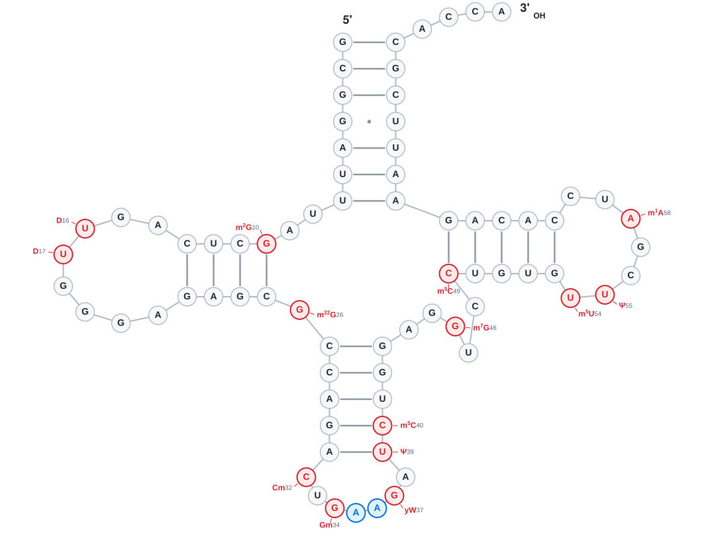
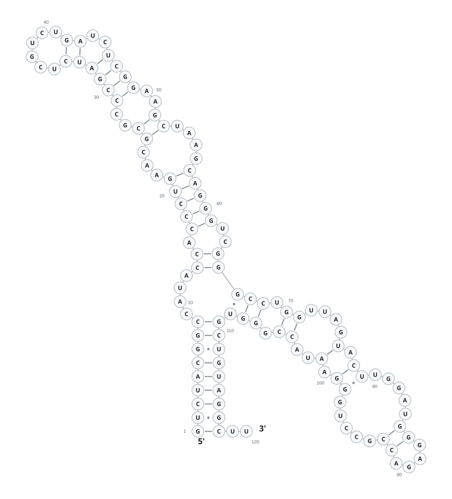
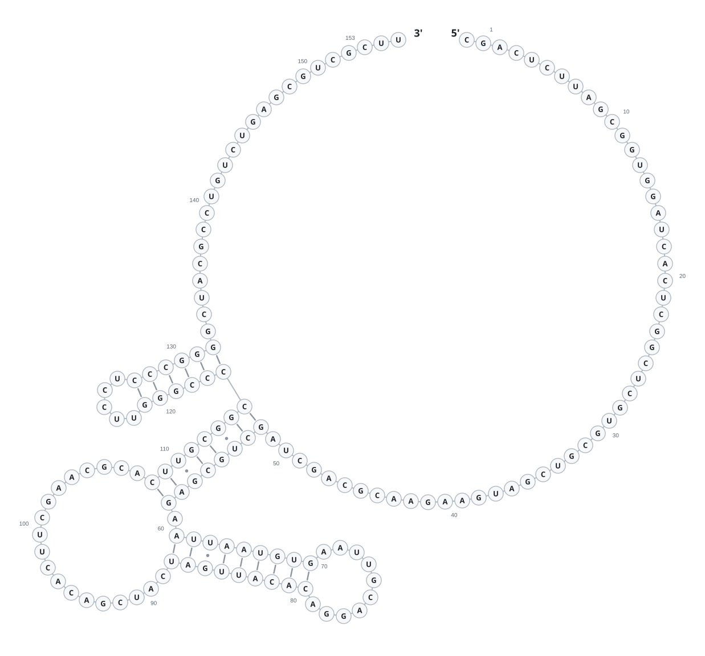

# RNA Layout Tool

Publication-focused RNA figure editor for drawing clean RNA secondary-structure maps from explicit sequences, fixed templates, and manual annotations.

This is a structure plotting tool, not a structure prediction tool. The intended workflow is:

```text
reference sequence + fixed structure template + annotation table -> publication-style RNA figure
```

## Current Capabilities

- Draws tRNA cloverleaf figures using stable Sprinzl-style template slots.
- Draws 5S rRNA with a fixed literature-style secondary-structure template.
- Displays nucleotides as editable SVG text for publication output.
- Draws base-pairing lines from template-defined pairs or user-provided dot-bracket input.
- Recognizes lab modification codes and symbols from `symblol_notebook/symbol_mapping.csv`.
- Supports manual display position labels, including ambiguous tRNA positions such as `17A`, `20A`, and `20B`.
- Supports separate annotation layers for modifications, bisulfite candidates, terminal chemistry, isoforms, truncations, and extensions.
- Exports SVG, PNG, and figure JSON.

## Layout Presets

- `tRNA Cloverleaf`
- `rRNA 5S Secondary Structure`
- `mRNA Linear Strand`
- `miRNA Hairpin`
- `Free canvas`

The old artificial `rRNA Compact Fold` behavior has been replaced. rRNA rendering now uses a fixed 5S rRNA coordinate template and does not generate spiral, circular, force-directed, or random folds.

## tRNA Notes

tRNA layout uses a Sprinzl-style scaffold, but some positions need human judgment. In particular, positions such as `17`, `17A`, `20`, `20A`, and `20B` should be manually confirmed.

Use the `Position Editor` panel:

- `Display position label`: the label shown on the figure.
- `Reference slot`: the template slot used as a coordinate reference.

This lets the user decide whether a nucleotide should be labeled `17A`, `20B`, left blank, or given another lab-specific label.

## 5S rRNA Notes

The 5S rRNA preset is template-based:

```text
position | base | x | y | paired_with | region | optional label
```

The first implementation targets 120 nt 5S rRNA. If the input sequence length is not 120, the app shows a warning and keeps the fixed template visible instead of drawing a broken partial structure.

The 5S pairing is taken from a published reference and is not predicted by the tool:

- Sequence: human 5S rRNA, positions 1-120 (GenBank X71804.1, the human entry in the Rfam RF00001 seed alignment).
- Structure: the Rfam RF00001 consensus secondary structure (published structure, PMID 11283358) projected onto that sequence. It has 34 base pairs, 30 Watson-Crick and 4 G·U on the human sequence, with helix I pairing 1-9 with 110-118.

Template coordinates for the text themes are generated from that pairing. Sequences from other species are drawn on the same pairing; pairs that are not Watson-Crick or G·U for the pasted sequence are marked.

## Modification Input

The sequence parser recognizes both standard bases and modification tokens. Examples:

```text
Gm
m1A
m7G
ms2i6A
D
psi
K   -> m1G
B   -> Cm
J   -> Um
P   -> psi
T   -> m5U
*   -> ms2i6A
```

Numbers in modification symbols are rendered as superscripts on the canvas, for example `i6A` and `m7G`.

## Display Themes

Three themes are available:

- `Publication`: plain text, clean pairing lines, manuscript-friendly output.
- `Light`: interactive editing view with visible nucleotide handles.
- `Bubble`: one circle per nucleotide with the base letter inside, a thin backbone, a line for Watson-Crick pairs and a dot for G·U pairs. Modified positions are outlined in red and labelled outside the figure; anticodon positions 34-36 are blue. Turn on `Show modified positions` to add the position number to each modification label.



The figure above is an unedited `Export SVG` of yeast tRNA-Phe (a public reference sequence) with its 14 known modifications. To reproduce it, paste this into the sequence box with the `tRNA Cloverleaf` preset and pick the `Bubble` theme:

```text
G C G G A U U U A m2G C U C A G D D G G G A G A G C m22G C C A G A Cm U Gm A A yW A psi m5C U G G A G m7G U C m5C U G U G m5U psi C G m1A U C C A C A G A A U U C G C A C C A
```

In the Bubble theme, unpaired bases that would overlap are nudged apart for display only; stored coordinates and paired bases keep their template positions.

### Bubble theme on the rRNA presets

The 5S and 5.8S templates store coordinates tuned for plain text, which are too tight for one circle per base. When the Bubble theme is active on these presets, the tool keeps the template's pairing map and re-arranges the coordinates from it: stacked pairs become ladders, each loop becomes a circle, and a long unpaired exterior (the 5.8S leader and tail) runs around an open ring. Switching back to `Publication` or `Light` restores the fixed template coordinates. Entering or leaving Bubble on an rRNA preset rebuilds the scaffold, so manual drags made in the other arrangement are not carried across.

| 5S rRNA | 5.8S rRNA |
| --- | --- |
|  |  |

Both figures are exports of public human reference sequences. Pair markers follow the sequence: a line is a Watson-Crick pair, a filled dot is G·U, and an open circle is a template pair that is neither for this sequence. The pairing itself comes from the fixed template and is not a structure prediction. The 5S template follows the Rfam RF00001 reference, so the human 5S figure has no open circles. The 5.8S template pairing has not been checked against a reference yet; its open circles mark pairs that do not fit the human sequence.

Older project JSON files using removed themes are normalized to `Publication` on import.

## Run Locally

```bash
npm install
npm run dev
```

Open [http://localhost:3000](http://localhost:3000).

## Build

```bash
npm run build
npm run start
```

## Tests

```bash
npm run test:structure
```

The structure test covers tRNA template mapping, modification parsing, dot-bracket pairing, the fixed 5S rRNA template, the Bubble theme geometry (no overlapping bubbles or labels on yeast tRNA-Phe), and the Bubble arrangement of the 5S and 5.8S presets (no overlaps, pairing unchanged).

## Export Figures

- Use `Export SVG` for Illustrator, PowerPoint, manuscript editing, and publication workflows.
- Use `Export PNG` for quick sharing.
- Use `Export JSON` to save sequence, slot mapping, pair edges, modifications, and annotations.

## Deploy To Vercel

Vercel can deploy this repository directly from GitHub.

1. Import the repository in Vercel.
2. Keep the default Next.js settings.
3. Vercel will run `npm run build` automatically.

The included `vercel.json` pins the framework to Next.js.

## Project Structure

```text
src/app/          Next.js app entry and global styles
src/components/   Toolbar, inspector, and SVG canvas
src/lib/          RNA data model, templates, parsers, layout, export helpers
scripts/          Layout and renderer regression tests
symblol_notebook/ Lab modification mapping CSV files
```

## Repository

[https://github.com/Chencharl/rna-layout-tool](https://github.com/Chencharl/rna-layout-tool)
